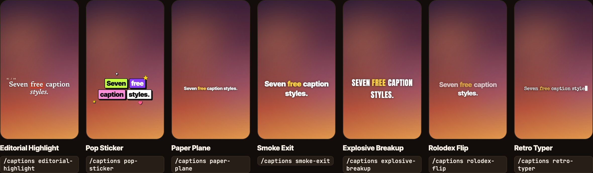

# 7 Free Caption Styles for Claude

Free animated captions for Instagram Reels, TikTok and YouTube Shorts, made inside Claude Code. Drop your video into Claude, type `/captions` and a style. You get your video back with animated captions, timed to your voice.

Made by [@vibha.in.progress](https://instagram.com/vibha.in.progress) 💛

> **Want the full set?** These 7 are the free starter pack from **[Hop Studio, my AI video editing studio inside Claude](https://vibha.is/ai-video-studio?source=captions-repo)**: 30+ caption styles (words behind your head, liquid glass, captions on the walls of your room), 220+ video effects and 150 sound effects. It runs on the Claude plan you already have.



## Install (one line)

Open the Terminal app (or the terminal inside Claude Code) and paste:

```bash
git clone https://github.com/Vibha-Ramprakash/claude-caption-styles ~/.claude/skills/captions
```

On Windows (PowerShell), use `$HOME\.claude\skills\captions` instead of `~/.claude/skills/captions`.

Then restart Claude Code.

> Not sure how? Open Claude Code and paste: **"Install the skill from github.com/Vibha-Ramprakash/claude-caption-styles into ~/.claude/skills/captions"**. Claude will do it for you.

## Use it

1. Open Claude Code.
2. Drag your video into the chat.
3. Type the style you want:

```
/captions pop-sticker
/captions smoke-exit with coral highlights
/captions retro-typer, a bit higher on screen
```

Claude finds every word you say, picks one key word per line to highlight, shows you a few check frames, then saves `yourvideo_pop-sticker.mp4` next to your original. Your video and audio stay exactly as they were.

The first time, Claude sets itself up (a couple of minutes). It needs ffmpeg, Node, Python and Google Chrome, and it installs what's missing.

## The 7 styles

| Type this | What happens |
|---|---|
| `editorial-highlight` | Magazine serif, the key word lands on a red paper strip |
| `pop-sticker` | Bold colour blocks with stickers popping around them |
| `paper-plane` | A paper plane flies across and pulls your words in |
| `smoke-exit` | Chunky words that dissolve into smoke at the end of each line |
| `explosive-breakup` | Big caps that blast apart, the key word in sparks |
| `rolodex-flip` | Each new word flips down like a rolodex card |
| `retro-typer` | Typewriter letters typed in time with your voice |

## See them on your own video first

Open `index.html` in Chrome. All 7 play side by side. Click **Choose video** and **Choose words file** to try each style on you before you render. (No words file yet? Type `/captions words my-video.mp4` in Claude.)

## Good to know

- This is the starter pack: captions sit on top of your video. Words behind your head, liquid glass, text on the walls of your room and 23+ more caption styles are in **[Hop Studio](https://vibha.is/ai-video-studio?source=captions-repo)**, the AI video editing studio that runs inside Claude.
- iPhone HDR videos can look washed out. Export as SDR first, or set Settings > Camera > Formats > Most Compatible.
- Free to use, MIT licence. A tag when you post is always appreciated 💛

## More free tools for editing videos with Claude

- **[51 free video effects for Claude](https://github.com/Vibha-Ramprakash/claude-video-effects)**: orbit, spotlight, glass widgets, comment box and more. Type `/effects orbit`.
- **[Hop Studio · AI video editing studio](https://vibha.is/ai-video-studio?source=captions-repo)**: the full studio with 220+ effects, 30+ caption styles, 150 sound effects and a free masterclass.
- New styles every week on Instagram: [@vibha.in.progress](https://instagram.com/vibha.in.progress)
